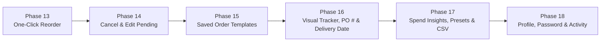

# Customer Dashboard — Ordering Management System (OMS) Roadmap (Phases 13–18)

**Status:** Planned Roadmap  
**Target Area:** Customer & Company Dashboard (`/dashboard`) + Global Cart Drawer + Supporting APIs & Migrations

> **Core Stack:** PHP 8.4 (Slim 4, `slim/php-view`, PHP-DI, `dibi`, `firebase/php-jwt` via `HttpOnly` cookies, Phinx migrations, PHPMailer, Dompdf, PHPUnit) • MySQL 8.4 • Tailwind CSS • Strict TypeScript + Modular Alpine.js + Native Fetch API.

---

## Goal Description

Phases 1–12 delivered the core ordering platform: a 98-item produce catalog with decimal (`0.1 kg`) and whole-unit (`Unit` / `Punnet`) ordering, JWT cookie authentication with password reset, a responsive dark-mode-enabled UI, a global slide-over cart drawer with product thumbnails, supplier order lifecycle management, and a Customer Dashboard with filtering, multi-select total spend, order detail modals, and Dompdf PDF statements.

To evolve the **Customer Dashboard** (`/dashboard`) into a complete, production-grade **Ordering Management System (OMS)** for both `customer` (retail) and `company` (wholesale/B2B) buyers, this roadmap defines **six incremental phases (Phases 13–18)** ordered by daily buyer utility and architectural dependency.

---

## Schema Changes Overview

- **Phase 14:** Extends `orders.status` ENUM to add `cancelled` (distinct from supplier-initiated `declined`) and adds `cancelled_at` (`DATETIME NULL`).
- **Phase 15:** Adds two new tables: `order_templates` and `order_template_items`.
- **Phase 16:** Adds `requested_delivery_date` (`DATE NULL`) and `po_number` (`VARCHAR(64) NULL`) to `orders`.

All schema changes will be delivered as reversible Phinx migrations and mirrored in `database/production_install.sql`.

---

## Phased Specification

### Phase 13 — One-Click Reorder ("Order Again") with Live Stock & Price Validation

**Why it matters:** Repeat produce buyers (restaurants, cafes, households) frequently re-order the same basket every week. Today they must manually re-add every item from the storefront.

- **[MODIFY] [`config/routes.php`](config/routes.php):**
  - Register `GET /api/v1/customer/orders/{id:[0-9]+}/reorder` under `RoleMiddleware('customer', 'company')` + `JwtCookieAuthMiddleware`.
- **[MODIFY] [`src/Controllers/CustomerDashboardController.php`](src/Controllers/CustomerDashboardController.php):**
  - Add `reorderPreview(Request $request, Response $response, array $args): Response`:
    - Fetches the customer's order items (`OrderRepository::findCustomerOrderDetail`) and loads live product state (`ProductRepository::findByIds`).
    - Categorizes each historical line item into:
      - `available`: active product with sufficient stock (returns current `unit_price`, `stock_quantity`, `image_path`, `allow_decimal`, `step_size`, and `price_changed` delta flag).
      - `adjusted`: active product where current stock is lower than ordered quantity (caps suggested quantity to available stock in valid `0.1` / `1` increments).
      - `unavailable`: inactive or zero-stock product (skipped with clear reason).
- **[MODIFY] [`src/Repositories/ProductRepository.php`](src/Repositories/ProductRepository.php):**
  - Add read-only `findByIds(array $productIds): array` (non-locking counterpart to `findByIdsForUpdate`).
- **[MODIFY] [`resources/ts/shared/cartStore.ts`](resources/ts/shared/cartStore.ts):**
  - Add `addBulkItems(items: CartItem[], mode: 'merge' | 'replace'): void` to populate the cart in one atomic persistence update.
- **[MODIFY] [`resources/ts/pages/customerDashboard.ts`](resources/ts/pages/customerDashboard.ts) & [`templates/customer/dashboard.php`](templates/customer/dashboard.php):**
  - Add a **"Reorder"** button on each desktop table row, mobile order card, and inside the Order Detail modal footer.
  - If the cart already has items, offer a quick choice (`Merge with cart` vs `Replace cart`); add available items, display a toast summarizing any adjusted/unavailable items or price changes, and immediately open `$store.cart.open()`.

---

### Phase 14 — Customer Self-Service: Cancel Pending Orders & Edit Pending Notes

**Why it matters:** Buyers need to cancel mistaken orders or update delivery gate instructions *before* the supplier starts packing, without calling or emailing support.

- **[NEW] `database/migrations/<timestamp>_add_cancelled_order_status.php`:**
  - Alter `orders.status` ENUM to `['pending', 'received', 'in_progress', 'delivered', 'declined', 'cancelled']`.
  - Add `cancelled_at DATETIME NULL` after `delivered_at`.
- **[MODIFY] [`src/Services/OrderService.php`](src/Services/OrderService.php):**
  - Add `cancelOrderByCustomer(int $orderId, array $authUser, ?string $reason = null): array`:
    - Locks the order row (`FOR UPDATE`), verifies ownership (`user_id === authUser.id`) and `status === 'pending'`.
    - Transitions status to `cancelled`, sets `cancelled_at`, logs an audit row in `order_status_history`, and **restores reserved stock** for all `order_items` inside the transaction.
    - Sends cancellation notification email to the supplier (and confirmation to customer) via `EmailService`.
  - Add `updatePendingOrderNotes(int $orderId, array $authUser, ?string $notes): array` allowing edits only while `status === 'pending'`.
- **[MODIFY] [`config/routes.php`](config/routes.php) & [`src/Controllers/CustomerDashboardController.php`](src/Controllers/CustomerDashboardController.php):**
  - Add `POST /api/v1/customer/orders/{id:[0-9]+}/cancel`
  - Add `PATCH /api/v1/customer/orders/{id:[0-9]+}/notes`
  - Update `CustomerDashboardController::orders()` and `ReportController` to support filtering by `cancelled` and displaying cancelled counts cleanly.
- **[MODIFY] [`templates/customer/dashboard.php`](templates/customer/dashboard.php) & [`resources/ts/pages/customerDashboard.ts`](resources/ts/pages/customerDashboard.ts):**
  - In the Order Detail modal (when `activeOrder.status === 'pending'`):
    - Show an inline **Edit Delivery Notes** control.
    - Show a **"Cancel Order"** action with a confirmation prompt and optional cancellation reason.
  - Add `cancelled` status badge styling and filter option across Customer and Supplier dashboards.

---

### Phase 15 — Saved Order Templates / Standing Lists ("Weekly Kitchen Order")

**Why it matters:** Wholesale/company buyers typically place 2–3 recurring baskets (e.g., *Monday Prep*, *Weekend Fruit Box*). Templates let them maintain reusable lists and check out in seconds.

- **[NEW] `database/migrations/<timestamp>_create_order_templates_tables.php`:**
  - `order_templates`: `id`, `user_id` (FK -> `users.id` CASCADE), `name` (`VARCHAR(120)`), `default_notes` (`TEXT NULL`), timestamps, index on `(user_id, name)`.
  - `order_template_items`: `id`, `template_id` (FK -> `order_templates.id` CASCADE), `product_id` (FK -> `products.id` CASCADE), `quantity` (`DECIMAL(10,2)`), unique index on `(template_id, product_id)`.
- **[NEW] `src/Repositories/OrderTemplateRepository.php` & `src/Controllers/OrderTemplateController.php`:**
  - Full scoped CRUD for the authenticated customer/company:
    - `GET /api/v1/customer/templates` — list templates with live item count, estimated current total, and stock availability summary.
    - `POST /api/v1/customer/templates` — create a template from current cart items or from an existing `order_id`.
    - `PATCH /api/v1/customer/templates/{id}` — rename, update `default_notes`, or update item quantities.
    - `DELETE /api/v1/customer/templates/{id}` — delete template.
    - `POST /api/v1/customer/templates/{id}/load` — return live validated items ready for `$store.cart.addBulkItems()`.
- **[MODIFY] [`templates/layouts/base.php`](templates/layouts/base.php), [`templates/customer/dashboard.php`](templates/customer/dashboard.php) & [`resources/ts/pages/customerDashboard.ts`](resources/ts/pages/customerDashboard.ts):**
  - Add **"Save Cart as Template"** button inside the global Cart Drawer (for logged-in `customer`/`company` users).
  - Add **"Save as Template"** button inside the Order Detail modal.
  - Add a **"Saved Lists"** tab on `/dashboard` showing template cards with item previews, live ZAR estimate, edit modal, delete, and one-click **"Load into Cart"**.

---

### Phase 16 — Visual Order Progress Tracker, PO Reference & Delivery Scheduling

**Why it matters:** In a full OMS, B2B buyers need to attach their internal Purchase Order (PO) number, specify a target delivery date, and visually track where each order is in fulfillment.

- **[NEW] `database/migrations/<timestamp>_add_po_and_delivery_date_to_orders.php`:**
  - Add `po_number VARCHAR(64) NULL` and `requested_delivery_date DATE NULL` to `orders`, with index on `(user_id, requested_delivery_date)`.
- **[MODIFY] [`src/Services/OrderService.php`](src/Services/OrderService.php), [`src/Repositories/OrderRepository.php`](src/Repositories/OrderRepository.php) & [`src/Services/PdfReportService.php`](src/Services/PdfReportService.php):**
  - Validate and store optional `po_number` (max 64 chars) and `requested_delivery_date` (`YYYY-MM-DD`, not in the past) during `placeOrder()`.
  - Allow searching orders by `po_number` or product name in `findCustomerOrders()`.
  - Display `PO #` and `Requested Delivery Date` on PDF invoices/statements, confirmation emails, and supplier order views.
- **[MODIFY] [`templates/layouts/base.php`](templates/layouts/base.php), [`resources/ts/shared/cartDrawer.ts`](resources/ts/shared/cartDrawer.ts) & [`templates/customer/dashboard.php`](templates/customer/dashboard.php):**
  - Add optional **Requested Delivery Date** date picker and **PO / Reference #** input to the Cart Drawer checkout footer.
  - Add a **4-step Visual Progress Stepper** (`Pending` -> `Received` -> `In Progress` -> `Delivered`, with clear terminal indicator for `Declined` / `Cancelled`) at the top of the Order Detail modal showing exact timestamps for each completed step.

---

### Phase 17 — Spend Analytics, Quick Date Presets, Search/Pagination & CSV Export

**Why it matters:** Bookkeepers and kitchen managers need quick period comparisons, top-purchased produce insights, and spreadsheet exports (Excel / Sage / Xero) alongside PDF statements.

- **[MODIFY] [`src/Repositories/OrderRepository.php`](src/Repositories/OrderRepository.php) & [`src/Controllers/CustomerDashboardController.php`](src/Controllers/CustomerDashboardController.php):**
  - Add `GET /api/v1/customer/analytics` returning:
    - **Monthly spend trend** (last 6 months, delivered vs open spend).
    - **Category spend breakdown** (Fruit, Vegetable, Herb, Mushrooms, Eggs).
    - **Top 5 most-ordered products** (with live `product_id`, total qty, total spend, and current price for quick `+ Add to Cart`).
  - Enhance `GET /api/v1/customer/orders` with optional `product_search` (filter orders containing a specific produce item), `sort_by` (`ordered_at` | `total_amount` | `status`), `sort_dir` (`asc` | `desc`), and `page` / `per_page` pagination metadata.
- **[MODIFY] [`src/Controllers/ReportController.php`](src/Controllers/ReportController.php) & [`config/routes.php`](config/routes.php):**
  - Add `GET /api/v1/customer/reports/csv` supporting the same filter/selection parameters as the PDF endpoint, streaming an RFC 4180 CSV (`Order #, Date, PO #, Status, Items, Total (ZAR)` or line-item detail mode `detail=items`).
- **[MODIFY] [`templates/customer/dashboard.php`](templates/customer/dashboard.php) & [`resources/ts/pages/customerDashboard.ts`](resources/ts/pages/customerDashboard.ts):**
  - Add **Quick Date Preset pills** (`This Week`, `This Month`, `Last 30 Days`, `This Quarter`, `All Time`).
  - Add **"Export CSV"** button alongside PDF export actions.
  - Add an **"Insights"** tab/panel with lightweight pure-CSS/Tailwind bar charts (zero external chart library bloat, full light/dark mode support) and a **"Top Ordered Items"** quick-add list.

---

### Phase 18 — Account & Delivery Profile Self-Service + Notification History

**Why it matters:** Buyers currently cannot update their company name, contact person, phone, or delivery address, nor change their password while signed in.

- **[MODIFY] [`src/Repositories/UserRepository.php`](src/Repositories/UserRepository.php) & [`src/Repositories/EmailLogRepository.php`](src/Repositories/EmailLogRepository.php):**
  - Add `UserRepository::updateProfile(int $userId, array $fields): void` for `company_name`, `contact_name`, `phone`, and `location`.
  - Add `EmailLogRepository::findRecentByUserId(int $userId, int $limit = 20): array` returning recent order confirmation & status notification records.
- **[NEW] `src/Controllers/CustomerProfileController.php` & [MODIFY] [`config/routes.php`](config/routes.php):**
  - `GET /api/v1/customer/profile` — returns current profile + recent notification log.
  - `PATCH /api/v1/customer/profile` — validates and updates profile fields; refreshes `authStore.user`.
  - `POST /api/v1/customer/change-password` — verifies current password via `password_verify()`, validates strong new password, updates hash via `UserRepository::updatePassword()`.
- **[MODIFY] [`templates/customer/dashboard.php`](templates/customer/dashboard.php) & [`resources/ts/pages/customerDashboard.ts`](resources/ts/pages/customerDashboard.ts):**
  - Add a **"Profile & Settings"** tab on `/dashboard` containing:
    - Delivery & Contact Details form (pre-populated from `$store.auth.user`).
    - Change Password form.
    - Recent Order Emails / Notification Log table (showing timestamp, email type, subject, and sent status).

---

## Verification Plan & Release Gate

Every phase follows the project's **Mandatory Release Gate**:

1. **PHPUnit Test Suite** (`vendor/bin/phpunit`):
   - Phase 13: `tests/Integration/CustomerReorderTest.php`
   - Phase 14: `tests/Integration/CustomerOrderCancelAndNotesTest.php`
   - Phase 15: `tests/Integration/OrderTemplatesTest.php`
   - Phase 16: `tests/Integration/DeliveryDateAndPoNumberTest.php`
   - Phase 17: `tests/Integration/CustomerAnalyticsAndCsvTest.php`
   - Phase 18: `tests/Integration/CustomerProfileTest.php`
2. **TypeScript Strict Typecheck:** `npm run typecheck` (`npx tsc --noEmit`).
3. **Production Asset Build:** `npm run build` (`tailwindcss` + `esbuild`).
4. **Phinx Migrations:** `vendor/bin/phinx migrate` (and rollback verification).
5. **UI & Security Verification:** Desktop & mobile viewports in Light & Dark Mode; strict role isolation and cross-user 404 checks.
6. **Git Workflow:** Commit on phase branch (`phase-13-...`), push to `origin`, merge into `main`, and push `main`.
