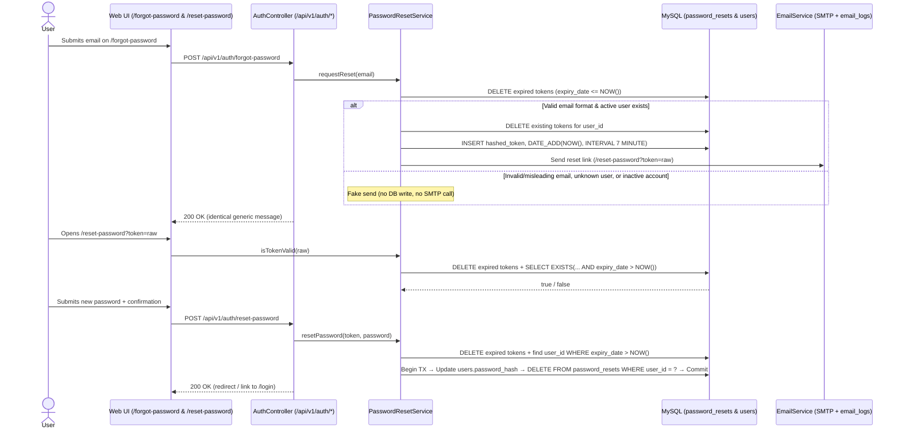

# Phase 9 — Password Reset Implementation Plan

**Status:** Locked In & Ready for Execution  
**Parent Blueprint:** [`ordering_system_plan.md`](ordering_system_plan.md) (Phase 9)

---

## Goal Description

Add a secure, end-to-end **Password Reset** flow ("Forgot Password" → emailed single-use reset link → "Set New Password" → sign in) to the Produce & Inventory Ordering System.

Key design principles:
- **MySQL-side expiry math & comparison**: Token expiry is computed in MySQL via `DATE_ADD(NOW(), INTERVAL %i MINUTE)` with a **7-minute** minimum lifespan (`TOKEN_TTL_MINUTES = 7`), and validity checks compare `expiry_date > NOW()` in MySQL, returning a strict `bool` (`true` / `false`). This keeps all time checks on a single database clock with zero PHP/MySQL timezone drift.
- **Self-cleaning `password_resets` table**: Rows are deleted immediately after a successful password reset (`DELETE FROM password_resets WHERE user_id = %i`), when a user requests a replacement token, and whenever expired/invalid rows are encountered (`DELETE FROM password_resets WHERE expiry_date <= NOW()`). Because redeemed and expired rows are removed, no `used_at` column is needed.
- **No user enumeration & faked send on misleading input**: `POST /api/v1/auth/forgot-password` **always** returns the exact same `200 OK` generic response (`"If an account exists for that email address, a password reset link has been sent."`) whether the input is a valid existing email, a non-existent email, a deactivated account, or misleading/malformed input (empty string, invalid email syntax, overly long string, etc.). No token is created and no email is sent for invalid/unknown/inactive inputs, and the JSON shape in non-debug mode is byte-for-byte identical.
- **Uniform token error messaging**: `GET /reset-password` and `POST /api/v1/auth/reset-password` return the exact same generic invalid/expired message for missing, malformed, unknown, expired, or already-redeemed tokens.



---

## Final `password_resets` Schema

| Column | Type | Constraints / Notes |
|---|---|---|
| `id` | `INT UNSIGNED` | `AUTO_INCREMENT PRIMARY KEY` |
| `user_id` | `INT UNSIGNED` | `NOT NULL`, `INDEX idx_password_resets_user_id`, `FK -> users(id) ON DELETE CASCADE` |
| `hashed_token` | `VARCHAR(100)` | `NOT NULL`, `UNIQUE KEY unique_token (hashed_token)` |
| `expiry_date` | `DATETIME` | `NOT NULL`, `INDEX idx_password_resets_expiry_date` (set via `DATE_ADD(NOW(), INTERVAL 7 MINUTE)`) |
| `created_at` | `DATETIME` | `NOT NULL DEFAULT CURRENT_TIMESTAMP` |

No `used_at` column is required since rows are cleaned up immediately after reset, replacement, or expiry.

---

## Proposed Changes

### 1. Database Schema (Phinx Migration)

#### `[NEW]` `database/migrations/20261126000200_create_password_resets_table.php`
Create the `password_resets` table matching InnoDB + `utf8mb4_unicode_ci` + unsigned PK conventions:

```php
$this->table('password_resets', ['signed' => false, 'engine' => 'InnoDB', 'collation' => 'utf8mb4_unicode_ci'])
    ->addColumn('user_id', 'integer', ['signed' => false, 'null' => false])
    ->addColumn('hashed_token', 'string', ['limit' => 100, 'null' => false])
    ->addColumn('expiry_date', 'datetime', ['null' => false])
    ->addColumn('created_at', 'datetime', ['default' => 'CURRENT_TIMESTAMP', 'null' => false])
    ->addIndex(['hashed_token'], ['unique' => true, 'name' => 'unique_token'])
    ->addIndex(['user_id'], ['name' => 'idx_password_resets_user_id'])
    ->addIndex(['expiry_date'], ['name' => 'idx_password_resets_expiry_date'])
    ->addForeignKey('user_id', 'users', 'id', [
        'delete' => 'CASCADE',
        'update' => 'NO_ACTION',
        'constraint' => 'fk_password_resets_user',
    ])
    ->create();
```

---

### 2. Data, Validation & Service Layer

#### `[MODIFY]` `src/Repositories/UserRepository.php`
Add `updatePassword(int $userId, string $passwordHash): void` to update `password_hash` and `updated_at` (`NOW()`) for `$userId`.

#### `[NEW]` `src/Repositories/PasswordResetRepository.php`
All expiry calculations and checks run in MySQL using `NOW()` and `INTERVAL %i MINUTE`:

```php
// Create token with MySQL-calculated expiry (minimum 7 minutes)
public function create(int $userId, string $hashedToken, int $ttlMinutes = 7): int
{
    $minutes = max(7, $ttlMinutes);
    $this->db->query(
        'INSERT INTO password_resets (user_id, hashed_token, expiry_date, created_at)
         VALUES (%i, %s, DATE_ADD(NOW(), INTERVAL %i MINUTE), NOW())',
        $userId,
        $hashedToken,
        $minutes
    );
    return $this->db->getInsertId();
}

// Clean up all expired tokens in MySQL
public function deleteExpired(): int
{
    $this->db->query('DELETE FROM password_resets WHERE expiry_date <= NOW()');
    return $this->db->getAffectedRows();
}

// Clean up all reset records for a user (after reset or before issuing a new token)
public function deleteForUser(int $userId): void
{
    $this->db->query('DELETE FROM password_resets WHERE user_id = %i', $userId);
}

// Clean up expired rows and return strict bool whether hashed_token is valid right now
public function isTokenValid(string $hashedToken): bool
{
    $this->deleteExpired();

    $exists = (int) $this->db->query(
        'SELECT EXISTS(
            SELECT 1 FROM password_resets
            WHERE hashed_token = %s AND expiry_date > NOW()
        )',
        $hashedToken
    )->fetchSingle();

    return $exists === 1;
}

// Clean up expired rows and return the owning user_id if the token is still valid, or null
public function findValidUserIdByHashedToken(string $hashedToken): ?int
{
    $this->deleteExpired();

    $userId = $this->db->query(
        'SELECT user_id FROM password_resets
         WHERE hashed_token = %s AND expiry_date > NOW()
         LIMIT 1',
        $hashedToken
    )->fetchSingle();

    return $userId !== false && $userId !== null ? (int) $userId : null;
}
```

#### `[MODIFY]` `src/Support/Validator.php`
Add `validatePasswordReset(array $input): array`:
- `token`: non-empty string
- `password`: 8–128 characters (matching `validateRegistration`)
- `confirm_password` (if provided): must match `password`

#### `[NEW]` `src/Services/PasswordResetService.php`
Constants:
- `public const TOKEN_TTL_MINUTES = 7;`
- `public const GENERIC_REQUEST_MESSAGE = 'If an account exists for that email address, a password reset link has been sent.';`
- `public const GENERIC_INVALID_TOKEN_MESSAGE = 'This password reset link is invalid or has expired.';`

Methods:
- `requestReset(string $email): array`
  - Calls `$this->passwordResetRepository->deleteExpired()` to keep the table clean.
  - Normalizes `$email = strtolower(trim($email))`.
  - If `!Validator::isValidEmail($email)` or `mb_strlen($email) > 191`: **fakes sending** — returns `['ok' => true, 'status' => 200, 'message' => self::GENERIC_REQUEST_MESSAGE]` without touching `users`, `password_resets`, or `EmailService`.
  - Looks up user by email; if missing or `(int) ($user['is_active'] ?? 0) !== 1`: **fakes sending** — returns the exact same `200 OK` generic response (no token, no email).
  - Deletes any existing reset rows for `$userId` (`deleteForUser($userId)`).
  - Generates `$rawToken = bin2hex(random_bytes(32))` and `$hashedToken = hash('sha256', $rawToken)`.
  - Calls `create($userId, $hashedToken, self::TOKEN_TTL_MINUTES)`.
  - Sends HTML + plain-text email via `EmailService::send(..., emailType: 'password_reset')` stating the link expires in **7 minutes**.
  - Returns `['ok' => true, 'status' => 200, 'message' => self::GENERIC_REQUEST_MESSAGE]` (no `email_sent` field leaked so valid and faked responses have identical JSON shape). Only when `$this->appDebug === true` does it include `debug_reset_url` for local development/testing.
- `isTokenValid(string $rawToken): bool`
  - Trims `$rawToken`; calls `deleteExpired()`; if empty or `strlen < 32`, returns `false`.
  - Computes `hash('sha256', $trimmed)` and returns `$this->passwordResetRepository->isTokenValid($hashedToken)` (`true` / `false`).
- `resetPassword(array $input): array`
  - Validates input via `Validator::validatePasswordReset($input)` (`422` on password policy/mismatch errors).
  - Calls `findValidUserIdByHashedToken(hash('sha256', trim($rawToken)))` (which also prunes expired tokens).
  - If `null`, returns `400` with `self::GENERIC_INVALID_TOKEN_MESSAGE` (uniform for malformed, unknown, expired, or already-used tokens).
  - Runs inside a DB transaction (`Connection::begin()` / `commit()` / `rollback()`):
    - Updates `users.password_hash` via `password_hash($password, PASSWORD_DEFAULT)`.
    - Marks `email_verified_at` if null (since user proved inbox ownership via the reset email).
    - Cleans up the table with `$this->passwordResetRepository->deleteForUser($userId)`.

---

### 3. Controller, Container & Routes

#### `[MODIFY]` `src/Controllers/AuthController.php`
Inject `PasswordResetService` and add:
- `showForgotPassword(Request, Response)` → renders `auth/forgot-password.php` (`pageScript => 'pages/auth.js'`).
- `showResetPassword(Request, Response)` → reads `?token=...`, calls `$this->passwordResetService->isTokenValid($token)` (`bool`), renders `auth/reset-password.php` with `token` and `tokenValid`.
- `forgotPassword(Request, Response)` → `POST /api/v1/auth/forgot-password`.
- `resetPassword(Request, Response)` → `POST /api/v1/auth/reset-password`.

#### `[MODIFY]` `config/container.php`
Wire `PasswordResetRepository` and `PasswordResetService` (passing `Connection`, `PasswordResetRepository`, `UserRepository`, `EmailService`, `app.url`, `app.name`, `app.debug`), and pass `PasswordResetService` to `AuthController`.

#### `[MODIFY]` `config/routes.php`
- Web views:
  - `GET /forgot-password` → `[AuthController::class, 'showForgotPassword']`
  - `GET /reset-password` → `[AuthController::class, 'showResetPassword']`
- Public Auth API endpoints:
  - `POST /api/v1/auth/forgot-password` → `[AuthController::class, 'forgotPassword']`
  - `POST /api/v1/auth/reset-password` → `[AuthController::class, 'resetPassword']`

---

### 4. Frontend Templates & TypeScript (Alpine.js)

#### `[MODIFY]` `templates/auth/login.php`
Add a **"Forgot password?"** link next to the Password label pointing to `/forgot-password`.

#### `[NEW]` `templates/auth/forgot-password.php`
Tailwind light/dark card with `x-data="forgotPasswordForm()"`: email input, submit button, generic confirmation banner (plus local debug link when `APP_DEBUG=true`), and "Back to Sign In" link.

#### `[NEW]` `templates/auth/reset-password.php`
- If `$tokenValid === false`: amber warning card explaining the reset link is invalid or has expired, with a button to request a new link (`/forgot-password`).
- If `$tokenValid === true`: `x-data="resetPasswordForm(...)"` with New Password + Confirm Password inputs, client-side match check, server error display, and a success confirmation state with a "Sign In Now" button.

#### `[MODIFY]` `resources/ts/pages/auth.ts`
Add `forgotPasswordForm()` and `resetPasswordForm(token: string)` to `registerAuthComponents()`.

---

### 5. Automated Tests

#### `[MODIFY]` `tests/Integration/SchemaAndSeedTest.php`
Assert `password_resets` exists in `SHOW TABLES`.

#### `[MODIFY]` `tests/Unit/ValidatorAndRoleMiddlewareTest.php`
Add unit tests for `Validator::validatePasswordReset()`.

#### `[NEW]` `tests/Integration/PasswordResetFlowTest.php`
End-to-end integration tests (`MAIL_DRY_RUN=true`) verifying:
1. Misleading/invalid inputs (`""`, `"not-an-email"`, `"admin'--@evil"`), non-existent emails, and deactivated accounts all return the exact same `200 OK` generic message (faked send) and write zero rows to `password_resets` or `email_logs`.
2. Active user receives a reset link; stored `hashed_token` != raw token; `TIMESTAMPDIFF(MINUTE, created_at, expiry_date) >= 7`; `email_logs` records `password_reset`.
3. Requesting a second reset removes the first row so only 1 row exists for the user, and the old token returns `false` / `400`.
4. An expired row (backdated via `DATE_SUB(NOW(), INTERVAL 1 MINUTE)`) returns `false` from `isTokenValid()`, returns `400` from `POST /api/v1/auth/reset-password`, and is **deleted** from `password_resets`.
5. Weak password returns `422` without deleting a still-valid token.
6. Valid reset updates password, **deletes** the user's row(s) from `password_resets`, rejects old password (`401`), succeeds with new password (`200`), and rejects token reuse (`400`).
7. `GET /forgot-password` and `GET /reset-password` render `200`.

---

## Verification Plan

### Automated Tests
```powershell
composer migrate
npm run typecheck
npm run build
composer test
```

### Manual Verification
1. Visit `/login` → click **"Forgot password?"** → submit email on `/forgot-password`.
2. Open the reset link (`/reset-password?token=...`), confirm the form loads, set a new password, and verify login works with the new password (and fails with the old one).
3. Confirm the `password_resets` table no longer contains the redeemed token row, and reopening the link shows the invalid/expired state.
